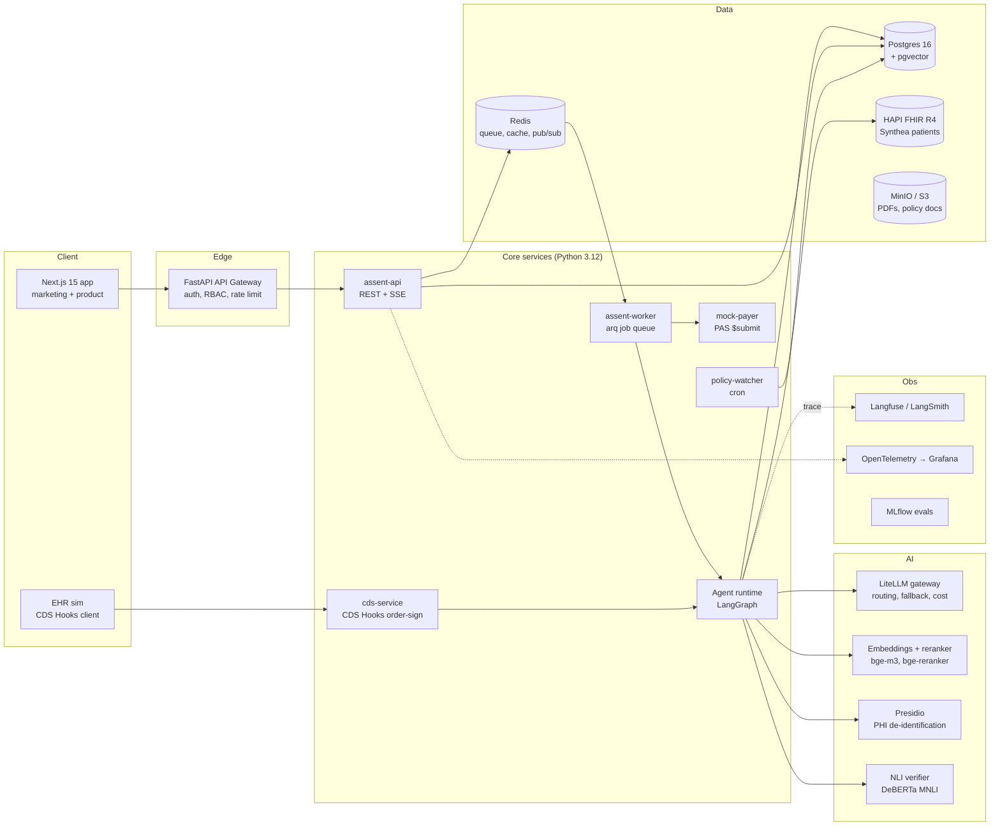
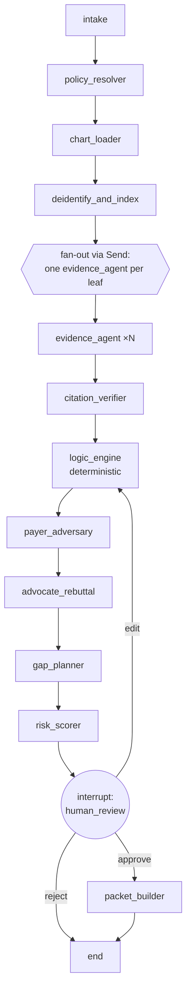

# Assent: System Architecture

This file covers how the backend is built, how requests are routed, how the AI agents and models are called, and how the data flows.

---

## 1. System overview



**Why it is shaped this way:**
- **API and worker are separate.** Agent runs take 20 to 90 seconds, so they never block a request. The API enqueues a job and streams progress over SSE from Redis pub/sub.
- **The LangGraph Postgres checkpointer** makes every run resumable and makes human-in-the-loop interrupts possible. A paused run survives restarts.
- **The Mock Payer is its own service.** It behaves like a real external system, with its own rules and latency, so the end-to-end loop is honest.
- **The LiteLLM gateway** keeps model choice out of the code, so you can swap providers, add fallbacks and track cost per case.

---

## 2. Tech stack

| Layer | Choice | Reason |
|---|---|---|
| API | FastAPI (async), Pydantic v2, SQLAlchemy 2.0 async, Alembic | Typed contracts and async I/O |
| Jobs | arq (Redis) | Lightweight async queue that fits FastAPI |
| Agents | LangGraph (StateGraph, Send API, interrupts, Postgres checkpointer) | Graph-based orchestration with HITL |
| LLM access | LiteLLM proxy | Multi-provider routing, retries, budgets |
| Vectors | pgvector (HNSW) + Postgres full-text (BM25 via `pg_search` or `tsvector`) | One database, hybrid search |
| Embeddings | `BAAI/bge-m3` served by TEI (Text Embeddings Inference) | Strong open model, runs locally |
| Reranker | `BAAI/bge-reranker-v2-m3` cross-encoder | Precision at top-k |
| PHI | Microsoft Presidio + custom recognizers (MRN, DOB) | De-identification before external calls |
| Verification | `microsoft/deberta-v2-xlarge-mnli` (or `cross-encoder/nli-deberta-v3-base` for speed) | Entailment check for citations |
| FHIR | HAPI FHIR JPA server (Docker), `fhir.resources` Python models | Standard R4 server |
| Data | Synthea (FHIR R4 bundles) + LLM-authored synthetic notes | No real PHI |
| Auth | Auth.js (frontend) + JWT verified in FastAPI; roles: coordinator, clinician, policy_admin, auditor | RBAC |
| Observability | Langfuse (LLM traces), OpenTelemetry, Prometheus/Grafana, MLflow (evals) | Glass-box behavior |
| Infra | Docker Compose (dev), GitHub Actions CI, deploy to Fly.io or AWS ECS + RDS | Reproducible |

---

## 3. Services

| Service | Port | Responsibility |
|---|---|---|
| `assent-api` | 8000 | REST, SSE, auth, all CRUD |
| `assent-worker` | n/a | Runs agent graphs, packet builds, submissions, evals |
| `cds-service` | 8010 | CDS Hooks discovery + `order-sign` hook |
| `mock-payer` | 8020 | `POST /Claim/$submit`, `GET /ClaimResponse/{id}`, configurable rules, latency, denial reasons |
| `policy-watcher` | n/a | Daily pull from the CMS Coverage API, diff, recompile drafts |
| `hapi-fhir` | 8080 | Patient data |
| `litellm` | 4000 | Model gateway |
| `tei-embed`, `tei-rerank` | 8081/8082 | Embeddings and reranking |

---

## 4. Data model (Postgres)

```text
organizations(id, name)
users(id, org_id, email, name, role)

policies(id, payer, kind[LCD|NCD], source_id, title, service_family)
policy_versions(id, policy_id, version, effective_date, raw_text, source_url,
                status[draft|approved|retired], approved_by, approved_at, content_hash)
criteria_nodes(id, policy_version_id, parent_id, key, kind[AND|OR|N_OF_M|LEAF],
               n_required, label, evidence_type, threshold_json, lookback_days,
               policy_span_start, policy_span_end, order_index)
policy_diffs(id, from_version_id, to_version_id, diff_json, created_at)

patients(id, fhir_id, display_name_synthetic, birth_year, sex)
cases(id, org_id, patient_id, service_family, cpt_codes[], icd10_codes[],
      policy_version_id, status[new|running|needs_review|ready|submitted|approved|denied|appealed],
      urgency[standard|expedited], sla_due_at, assignee_id, readiness_score,
      denial_risk, created_at, updated_at)

chart_chunks(id, case_id, fhir_resource_type, fhir_resource_id, effective_date,
             text_deid, char_offset, embedding vector(1024), tsv tsvector)

runs(id, case_id, trigger[auto|manual|rerun|appeal], graph_version, status,
     started_at, finished_at, total_tokens, total_cost_usd, langfuse_trace_id)
run_steps(id, run_id, node, status, started_at, finished_at, model, prompt_version,
          input_tokens, output_tokens, cost_usd, payload_json)

evidence_verdicts(id, run_id, criterion_id, verdict[met|not_met|insufficient],
                  confidence, rationale, overridden_by, override_reason)
evidence_citations(id, verdict_id, chunk_id, quote, start_char, end_char,
                   verbatim_ok bool, entailment_score)

objections(id, run_id, criterion_id, text, severity, status[rebutted|conceded|open],
           rebuttal_text, rebuttal_citation_ids[])
gap_tasks(id, case_id, criterion_id, title, detail, assignee_role, status, due_at)

packets(id, case_id, run_id, fhir_bundle_json, pdf_key, created_by, approved_by, approved_at)
submissions(id, packet_id, payer_endpoint, submitted_at, response_status,
            claim_response_json, denial_reason_code, denial_reason_text)
appeals(id, submission_id, draft_text, citations_json, status, sent_at)

eval_cases(id, service_family, gold_json, seeded_defects_json, split[dev|test])
eval_runs(id, git_sha, config_json, metrics_json, mlflow_run_id, created_at)

audit_log(id, actor_id, action, entity, entity_id, before_json, after_json, ts, hash_prev, hash)
```

`audit_log` is hash-chained: each row stores `sha256(prev_hash + row)`. The log is append-only and tamper-evident, which is a good point to bring up in interviews.

---

## 5. API routes (assent-api)

All routes are under `/api/v1`, use JWT bearer auth, and return JSON unless noted.

### Cases and worklist
| Method | Route | Purpose |
|---|---|---|
| GET | `/cases?status=&service=&assignee=&sort=sla` | Worklist with filters, cursor pagination |
| POST | `/cases` | Create a case `{patient_fhir_id, cpt_codes, icd10_codes, urgency}`. Resolves the policy and starts a run automatically |
| GET | `/cases/{id}` | Case header, latest run summary, readiness, risk |
| PATCH | `/cases/{id}` | Assign, change urgency, change status |
| GET | `/cases/{id}/timeline` | Normalized patient timeline (de-identified) |
| GET | `/cases/{id}/chart/{chunk_id}` | One chunk with highlighted spans |

### Runs (the agent)
| Method | Route | Purpose |
|---|---|---|
| POST | `/cases/{id}/runs` | Start a run `{trigger}` and return `{run_id}` (202) |
| GET | `/runs/{id}` | Run status + steps |
| GET | `/runs/{id}/stream` | **SSE**: live node events, token stream, verdicts |
| POST | `/runs/{id}/resume` | Resume after a human interrupt `{decision: approve|edit|reject, edits}` |
| GET | `/runs/{id}/graph` | Criteria graph with verdicts, for the visualizer |
| GET | `/runs/{id}/trace` | Full trace (models, tokens, cost, latency) |

### Evidence and review
| Method | Route | Purpose |
|---|---|---|
| GET | `/runs/{id}/verdicts` | All leaf verdicts + citations |
| PATCH | `/verdicts/{id}` | Human override `{verdict, reason}`. Audited and sent to the eval inbox |
| GET | `/runs/{id}/objections` | Payer Adversary objections and rebuttals |
| GET | `/cases/{id}/gaps` | Gap tasks |
| PATCH | `/gaps/{id}` | Update task status |

### Packets, submissions, appeals
| Method | Route | Purpose |
|---|---|---|
| POST | `/runs/{id}/packet` | Build a PAS Bundle + PDF |
| GET | `/packets/{id}` | Packet JSON. `?format=pdf` streams the PDF |
| POST | `/packets/{id}/approve` | Human approval (required before submit) |
| POST | `/packets/{id}/submit` | Submit to the Mock Payer (async) |
| GET | `/submissions/{id}` | Payer response |
| POST | `/submissions/{id}/appeal` | Start an appeal run |
| GET/PATCH | `/appeals/{id}` | Read or edit the appeal draft |

### Policies
| Method | Route | Purpose |
|---|---|---|
| GET | `/policies` | Library |
| POST | `/policies/{id}/compile` | Run the Policy Compiler on the latest text and return a draft version |
| GET | `/policy-versions/{id}` | Version + criteria tree |
| PUT | `/policy-versions/{id}/criteria` | Edit the tree (policy_admin) |
| POST | `/policy-versions/{id}/approve` | Publish |
| GET | `/policy-versions/{id}/diff/{other}` | Semantic diff |
| GET | `/policy-versions/{id}/questionnaire` | Export as a FHIR Questionnaire (DTR) |

### Evals, analytics, admin
| Method | Route | Purpose |
|---|---|---|
| GET | `/evals/runs` | Benchmark history |
| POST | `/evals/runs` | Start a benchmark `{split, config}` (admin) |
| GET | `/analytics/denials` | Denial reasons by payer, service and criterion |
| GET | `/analytics/throughput` | Cases/day, time to packet, SLA breaches |
| GET | `/audit?entity=&id=` | Audit log |
| GET | `/public/evals/latest` | **Unauthenticated**, for the marketing Evals page |
| POST | `/public/demo/run` | **Rate-limited** demo run on a fixed synthetic case, for the landing page |

### SSE event contract (`/runs/{id}/stream`)
```jsonc
{ "type": "node_started",   "node": "evidence_agent", "criterion_id": "c_2b", "ts": "..." }
{ "type": "retrieval",      "criterion_id": "c_2b", "chunks": [{"id":"ch_19","score":0.83}] }
{ "type": "token",          "node": "advocate", "delta": "The note dated..." }
{ "type": "verdict",        "criterion_id": "c_2b", "verdict": "met", "confidence": 0.91,
                            "citations": [{"chunk_id":"ch_19","start":120,"end":188}] }
{ "type": "logic_update",   "node_id": "c_2", "state": "met" }
{ "type": "objection",      "id": "ob_1", "text": "...", "severity": "high" }
{ "type": "interrupt",      "reason": "human_review", "payload": {...} }
{ "type": "node_finished",  "node": "...", "latency_ms": 2140, "cost_usd": 0.004 }
{ "type": "run_finished",   "readiness": 0.92, "denial_risk": 0.18 }
```
The frontend's criteria graph animation is driven directly by `retrieval`, `verdict` and `logic_update` events, so the motion on screen is real system state, not decoration.

### CDS Hooks service
| Method | Route | Purpose |
|---|---|---|
| GET | `/cds-services` | Discovery |
| POST | `/cds-services/assent-order-sign` | Takes `context.draftOrders` + prefetch, runs a fast pre-check, returns cards with gap checklists and a link to open the case |

### Mock Payer
| Method | Route | Purpose |
|---|---|---|
| POST | `/fhir/Claim/$submit` | Takes a PAS Bundle and returns a `ClaimResponse` (sync or pended) |
| GET | `/fhir/ClaimResponse/{id}` | Poll a pended decision |
| PUT | `/admin/rules` | Set hidden rules (strictness, random noise, documentation demands) |

---

## 6. The agent graph (LangGraph)

### 6.1 State
```python
class CaseState(TypedDict):
    case_id: str
    service_family: str
    policy_version_id: str
    criteria: list[CriterionNode]          # compiled graph, flattened
    timeline: list[TimelineEvent]          # normalized, de-identified
    verdicts: Annotated[list[Verdict], operator.add]   # reducer: parallel fan-in
    logic_result: LogicResult | None
    objections: list[Objection]
    gaps: list[GapTask]
    readiness: float
    denial_risk: float
    human_decision: HumanDecision | None
    packet_id: str | None
```

### 6.2 Graph


### 6.3 Nodes: what each does and how it calls models

| Node | Type | Model tier | What it does |
|---|---|---|---|
| `intake` | code | n/a | Validates CPT/ICD-10, sets the SLA clock (72h/7d) |
| `policy_resolver` | code + SQL | n/a | Maps CPT codes to a service family and the approved policy version for the patient's MAC jurisdiction |
| `chart_loader` | FHIR client | n/a | `$everything` on Patient with a date window equal to the max lookback across criteria |
| `deidentify_and_index` | Presidio + TEI | local | Replaces PHI with consistent surrogates, chunks notes (~400 tokens, sentence-aligned, 15% overlap), embeds, writes tsvector |
| `evidence_agent` | **LLM, tool-calling** | **Reasoning tier** | Per criterion: hybrid search (BM25 + dense + RRF), rerank to top 8, then a structured verdict with quotes. Has tools `search_chart(query)`, `get_resource(id)`, `compute_duration(start, end)`, `latest_observation(loinc, within_days)` |
| `citation_verifier` | code + NLI | local | Verbatim span check, then an entailment score. Below 0.7 the verdict is downgraded to `insufficient` |
| `logic_engine` | code | n/a | Evaluates the AND/OR/N_OF_M tree with three-valued logic. Records which leaves decided the outcome |
| `payer_adversary` | LLM | Reasoning tier, **different provider** than the Advocate | Persona: strict MAC medical reviewer. Sees only the packet, not the full chart. Returns objections tied to criteria |
| `advocate_rebuttal` | LLM + tools | Reasoning tier | For each objection: find evidence and rebut, or concede. One round (two at most) |
| `gap_planner` | LLM | Fast tier | Turns unmet, insufficient or conceded items into tasks with an assignee role and policy citation |
| `risk_scorer` | code | n/a | Calibrated logistic model on features (unmet leaves, open objections, entailment mean, evidence age), fit on eval data, with an isotonic calibration curve |
| `human_review` | `interrupt()` | n/a | Waits for the coordinator |
| `packet_builder` | code + LLM | Fast tier for the cover-letter prose | Builds the PAS Bundle (`Claim`, `supportingInfo` → `DocumentReference`s) and renders the PDF with WeasyPrint |

**Separate graphs:** `policy_compiler_graph` (fetch LCD, segment it, extract criteria with structured output, self-consistency vote ×3, human approval) and `appeal_graph` (parse denial, map to criteria, targeted re-search, draft letter, verify citations).

### 6.4 Model routing (LiteLLM config)

| Tier | Used for | Primary | Fallback | Settings |
|---|---|---|---|---|
| `reasoning` | evidence_agent, advocate, policy compiler | Claude Sonnet (latest) | GPT-4.1 / GPT-5 class | temp 0, structured output, prompt caching on the policy + system prefix |
| `adversary` | payer_adversary | **a different vendor from the Advocate** (e.g. GPT class if the Advocate is Claude) | Gemini Pro class | temp 0.3. Model diversity reduces shared blind spots |
| `fast` | gap_planner, cover letter, query rewriting | Claude Haiku / GPT-4.1-mini | Llama 3.1 8B on vLLM | temp 0.2 |
| `local` | embeddings, rerank, NLI, PHI | bge-m3, bge-reranker, DeBERTa-MNLI, Presidio | n/a | no PHI leaves the box |
| `open (stretch)` | criterion verdict classifier | **Llama 3.1 8B + QLoRA**, fine-tuned on reviewer overrides and the eval train split, served on vLLM | reasoning tier | Shows fine-tuning skills and cuts cost |

Pin model IDs in `litellm.yaml`, not in code. Each run records the exact model and prompt version.

### 6.5 How an evidence agent is called (sketch)
```python
class Citation(BaseModel):
    chunk_id: str
    quote: str = Field(description="Exact substring copied from the chunk")

class VerdictOut(BaseModel):
    verdict: Literal["met", "not_met", "insufficient"]
    confidence: float = Field(ge=0, le=1)
    rationale: str = Field(max_length=600)
    citations: list[Citation]

async def evidence_agent(state: EvidenceTask) -> dict:
    crit = state["criterion"]
    llm = chat_model("reasoning").bind_tools(CHART_TOOLS).with_structured_output(VerdictOut)
    msgs = [
        SystemMessage(EVIDENCE_SYSTEM_V3),             # cached prefix
        SystemMessage(render_policy_context(crit)),    # cached per policy version
        HumanMessage(render_criterion(crit, state["case_summary"])),
    ]
    out = await run_tool_loop(llm, msgs, max_steps=4)
    return {"verdicts": [Verdict.from_out(crit.id, out)]}

def fan_out(state: CaseState):
    return [Send("evidence_agent", {"criterion": c, "case_summary": summarize(state)})
            for c in state["criteria"] if c.kind == "LEAF"]
```

**Prompt rules the system prompt enforces:** quote verbatim, no paraphrase in `quote`; prefer the most recent evidence within the lookback window; if the evidence is ambiguous, answer `insufficient`, never `met`; never infer a value that is not written down.

### 6.6 Retrieval details
- **Query construction:** criterion label + evidence type synonyms (UMLS/SNOMED-flavored list per evidence type) + an LLM-rewritten query (fast tier). That gives 3 queries.
- **Hybrid:** BM25 top 30 + dense top 30, fused with Reciprocal Rank Fusion, then cross-encoder rerank down to 8.
- **Structured shortcut:** numeric criteria (BMI, AHI) try `latest_observation(LOINC)` first, before searching text.
- **Temporal filter:** chunks outside `lookback_days` are dropped before reranking.

---

## 7. Guardrails and safety
1. **PHI boundary:** only de-identified text reaches external LLMs. A unit test asserts that no raw-name/MRN regex hits appear in outbound payloads (checked on a LiteLLM callback).
2. **Citations or it didn't happen:** enforced in code (verifier), not only in the prompt.
3. **Structured outputs everywhere:** Pydantic schemas. One retry on validation errors, then a safe `insufficient`.
4. **Prompt-injection defense:** chart text is wrapped in delimited data blocks and the system prompt treats it as data. There is a test set of notes containing injected instructions.
5. **Budget limits:** per-run token and cost caps in LiteLLM. When a cap is hit, the run degrades to the fast tier.
6. **Human approval** is required to build and submit a packet (API-enforced role check + run state).

---

## 8. Observability
- **Langfuse** traces per run, linked from the UI's "Trace" tab via `langfuse_trace_id`.
- **OpenTelemetry** spans across api → worker → agent nodes → FHIR calls.
- **Metrics:** run latency p50/p95, cost per case, verdict distribution, override rate, SLA breach count.
- **MLflow:** every benchmark run logs config, git SHA, metrics and confusion matrices.

---

## 9. Security notes
- JWT with short-lived access tokens. Role checks run in FastAPI dependencies.
- Row-level org scoping on every query.
- Secrets live in env vars / AWS Secrets Manager, never in the repo.
- The audit log is hash-chained, and DB grants make it insert-only.
- CORS is locked to the web origin. Public demo endpoints are rate-limited (slowapi) and use a fixed synthetic case.
