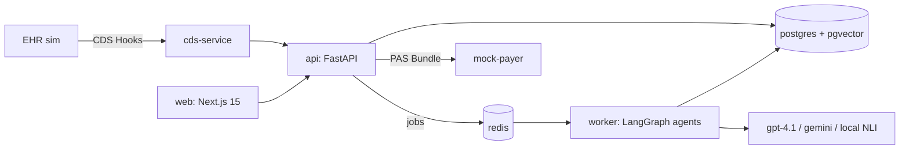

# Assent

<p align="center">
  
</p>

<p align="center">
  
  
  
</p>

Assent reads a patient's chart, proves each Medicare coverage criterion with exact chart evidence, stress-tests the packet against a simulated payer, and drafts an appeal when denied.

> **Important:** Synthetic patients only. No PHI.

---

## ✨ What Assent Does

1. **Compiles policy into logic**  
   Turns Medicare LCDs (for example, L39240) into typed AND/OR/N-of-M criterion trees with source links.
2. **Reads and indexes chart data**  
   Uses de-identified FHIR + notes and hybrid retrieval (Postgres full-text + pgvector + reranking).
3. **Builds criterion-level evidence**  
   One evidence agent per criterion returns `met`, `not met`, or `insufficient` with citations.
4. **Verifies citations before trust**  
   Quotes must match verbatim and entail claims (local NLI + LLM judge for `met` claims).
5. **Runs payer challenge simulation**  
   A payer adversary attacks the packet; an advocate rebuts or concedes and generates gap tasks.
6. **Submits and drafts appeals**  
   Produces PAS-style FHIR bundles + letters and drafts a cited appeal on denial.
7. **Integrates into clinical workflow**  
   CDS Hooks `order-sign` flags prior-auth needs and open evidence gaps.

Supported service families:
- Epidural steroid injections
- Hypoglossal nerve stimulation
- Percutaneous vertebral augmentation

---

## 📊 Results Snapshot

Locked test split (6 cases per family; details in `/evals` and [PRODUCT.md](PRODUCT.md)):

| Family | Decisions correct | Wrongly marked ready | Criterion F1 | Unsupported claims | Cost / case |
|---|---|---|---|---|---|
| Epidural steroid injection | 5 / 6 | 0 | 0.79 | 0% | $0.089 |
| Hypoglossal nerve stimulation | 6 / 6 | 0 | 0.66 | 0% | $0.068 |
| Vertebral augmentation | 5 / 6 | 0 | 0.86 | 0% | $0.081 |
| **All** | **16 / 18 (89%)** | **0** | **0.81** | **0%** | **$0.079** |

Key outcomes:
- No unproven case was incorrectly marked ready.
- Long-context single-prompt baseline had higher unsupported claims (28% vs Assent 0%).
- Payer adversary caught 60/60 seeded packet defects.
- 0/6 prompt-injection attacks flipped a decision.

---

## 🧠 Architecture



Core apps and packages:
- `apps/web`: Next.js UI, landing page, `/demo` replay, `/evals` report
- `apps/api`: FastAPI backend, auth/RBAC, audit log, SSE run streams
- `apps/worker`: arq job workers for runs and appeals
- `apps/mock_payer`, `apps/cds`: payer simulator + CDS Hooks service
- `packages/agents`: policy, evidence, verifier, adversary, appeals
- `packages/retrieval`, `packages/fhir`, `packages/phi`, `packages/evals`

Deep dive docs:
- [PRODUCT.md](PRODUCT.md)
- [ARCHITECTURE.md](ARCHITECTURE.md)
- [FRONTEND.md](FRONTEND.md)
- [BUILD_PLAN.md](BUILD_PLAN.md)
- [docs/STATUS.md](docs/STATUS.md)

---

## 🚀 Quick Start (Windows + PowerShell)

```powershell
. .\scripts\env.ps1
Copy-Item .env.example .env
uv sync --all-packages
pnpm install
.\scripts\dev.ps1 all
uv run uvicorn assent_mock_payer.main:app --port 8020
uv run uvicorn assent_cds.main:app --port 8010
```

After startup:
- Web app: http://localhost:3000
- Login: `coordinator@assent.dev` / `assent-dev`
- EHR simulator: `/ehr-sim`
- Public pages: `/`, `/demo`, `/evals` (no backend needed)

---

## 🛠️ Useful Commands

| Command | Purpose |
|---|---|
| `.\scripts\dev.ps1 test` | Run pytest + vitest |
| `uv run python -m assent_api.policy_load` | Load LCD snapshots + criteria trees |
| `uv run python -m assent_evals.synth.build --family esi\|hgns\|pva --notes llm` | Build synthetic benchmark data |
| `uv run python -m assent_evals.bench --family hgns --split dev --llm openai` | Run benchmark evaluation |
| `uv run python -m assent_evals.bench ... --variant long-context\|naive-rag\|no-verify` | Baselines and ablations |
| `uv run python -m assent_evals.adversary_eval` | Evaluate adversary defect detection |
| `uv run python -m assent_evals.report --split test` | Generate eval table report |

All LLM calls are cached in `data/fixtures/cassettes/` for reproducible reruns.

---

## 📌 Project Status

Phases 0–7 are complete: end-to-end agent pipeline, review, packets, payer + appeals loop, CDS Hooks, landing page, demo, and eval reporting.

Open items:
- Cloud backend deployment
- Live (non-replay) public demo
- Full 150-case benchmark run

See [docs/STATUS.md](docs/STATUS.md) for current handoff details.

---

Built by Karthikeya Moturi.
