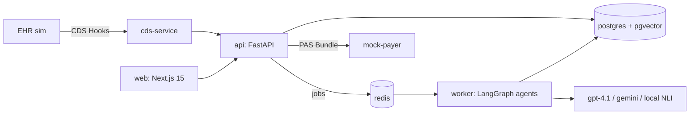

# Assent

**Prior authorization, argued with evidence.** Assent reads a patient's chart, proves every Medicare coverage criterion with a cited sentence, stress-tests the packet against a simulated payer, and drafts the appeal when a request is denied. Every claim it makes points at a verbatim quote; a separate verifier throws out the ones that don't hold.

Synthetic patients only. No PHI.

## What it does

1. **Compiles the coverage policy.** A Medicare LCD (e.g. L39240, epidural steroid injections) becomes a typed AND/OR/N-of-M tree of atomic criteria, each linked to its exact policy sentence.
2. **Reads the chart.** FHIR resources and notes are de-identified, chunked and indexed for hybrid search (Postgres full-text + pgvector + reranking).
3. **Proves each criterion.** One evidence agent per criterion answers met / not met / insufficient, citing chunk quotes.
4. **Verifies every citation.** Each quote must exist verbatim and entail its claim (local NLI plus an LLM judge on `met`); otherwise the verdict is downgraded to *insufficient* rather than guessed.
5. **Argues with the payer.** A payer adversary on a different model vendor attacks the packet; an advocate rebuts with new citations or concedes, and concessions become gap tasks for a human.
6. **Submits and appeals.** A human approves; Assent builds a Da Vinci PAS-style FHIR Bundle plus PDF letter, submits it to a mock payer with hidden rules, and on denial re-searches the chart and drafts a cited appeal.
7. **Shows up in the EHR.** A CDS Hooks `order-sign` service flags the prior-auth requirement and open gaps when a clinician signs the order.

Service families: epidural steroid injections, hypoglossal nerve stimulation, and percutaneous vertebral augmentation, all of them in Medicare's 2026 WISeR prior-authorization model.

## Results

Locked test split, run once (6 cases per family, trimmed for API cost; full details and failures in the `/evals` page and [PRODUCT.md §6](PRODUCT.md)):

| Family | Decisions correct | Wrongly marked ready | Criterion F1 | Unsupported claims | Cost / case |
|---|---|---|---|---|---|
| Epidural steroid injection | 5 / 6 | 0 | 0.79 | 0% | $0.089 |
| Hypoglossal nerve stimulation | 6 / 6 | 0 | 0.66 | 0% | $0.068 |
| Vertebral augmentation | 5 / 6 | 0 | 0.86 | 0% | $0.081 |
| **All** | **16 / 18 (89%)** | **0** | **0.81** | **0%** | **$0.079** |

- Every error held a ready case back for a human; none sent an unproven one.
- A long-context single prompt on the same cases decided more cases correctly but made **28% unsupported claims** (Assent: 0%).
- The payer adversary caught **60 / 60** seeded packet defects (and over-objects on clean packets: 3.1 per packet).
- **0 / 6** prompt-injection attacks flipped a decision.

## Architecture



- `apps/web`: Next.js 15, React Flow + ELK case workspace, a scroll-told React Three Fiber landing (one porcelain 3D world flown by Lenis, see [DESIGN.md](DESIGN.md)), `/demo` replay, `/evals` report
- `apps/api`: FastAPI, JWT + RBAC, hash-chained audit log, SSE run streams, packets / submissions / appeals
- `apps/worker`: arq jobs for case runs and appeals
- `apps/mock_payer`, `apps/cds`: the external payer and the CDS Hooks service
- `packages/agents`: policy compiler, evidence agent, verifier, adversary, gap planner, appeal agent, logic engine
- `packages/retrieval`, `packages/fhir`, `packages/phi`, `packages/evals`: search, FHIR + PAS bundles, de-identification, benchmark

Full design: [PRODUCT.md](PRODUCT.md), [ARCHITECTURE.md](ARCHITECTURE.md), [FRONTEND.md](FRONTEND.md), [BUILD_PLAN.md](BUILD_PLAN.md). Build log and decisions: [docs/STATUS.md](docs/STATUS.md).

## Run it locally (Windows, PowerShell)

```powershell
. .\scripts\env.ps1          # routes all tools/caches to D:
Copy-Item .env.example .env  # then fill in OPENAI_API_KEY (and GEMINI_API_KEY for the adversary)
uv sync --all-packages
pnpm install
.\scripts\dev.ps1 all        # postgres+redis, migrate, seed, api, worker, web
uv run uvicorn assent_mock_payer.main:app --port 8020
uv run uvicorn assent_cds.main:app --port 8010
```

Log in at http://localhost:3000/login as `coordinator@assent.dev` / `assent-dev`. The EHR simulator is at `/ehr-sim`; the public pages (`/`, `/demo`, `/evals`) need no backend.

One-time machine setup (no Docker): Postgres 16 + pgvector via `micromamba create -p D:\DevTools\pg16 -c conda-forge postgresql=16 pgvector`, `initdb -D D:\DevTools\pgdata -U assent`, portable Redis in `D:\DevTools\redis`, Node 22 via fnm, Python 3.12 via `uv python install`. `infra/docker-compose.yml` is the equivalent elsewhere.

| Command | What it does |
|---|---|
| `.\scripts\dev.ps1 test` | pytest + vitest |
| `uv run python -m assent_api.policy_load` | Load the 9 LCD snapshots + gold criteria trees |
| `uv run python -m assent_evals.synth.build --family esi\|hgns\|pva --notes llm` | Build a family's benchmark (fact sheets, notes, FHIR bundles) |
| `uv run python -m assent_evals.bench --family hgns --split dev --llm openai` | Score the pipeline against gold (resumable, `--max-usd` cap) |
| `uv run python -m assent_evals.bench ... --variant long-context\|naive-rag\|no-verify` | Baselines and ablations |
| `uv run python -m assent_evals.adversary_eval` | Seeded-defect catch rate for the payer adversary |
| `uv run python -m assent_evals.report --split test` | The eval table |

Every LLM call is recorded to `data/fixtures/cassettes/`, so re-running a benchmark with unchanged prompts costs nothing. `--llm oracle` is a perfect reviewer that only sees what retrieval shows it, for testing without an API key.

## Status

Phases 0 to 7 of the build plan are done: the agent pipeline, review, packets, payer and appeal loop, CDS Hooks, the landing page, demo and evals. Not yet done: cloud deployment of the backend, a live (non-replay) public demo, and the full 150-case benchmark run. Known gaps are listed in [docs/STATUS.md](docs/STATUS.md).

Built by Karthikeya Moturi.
